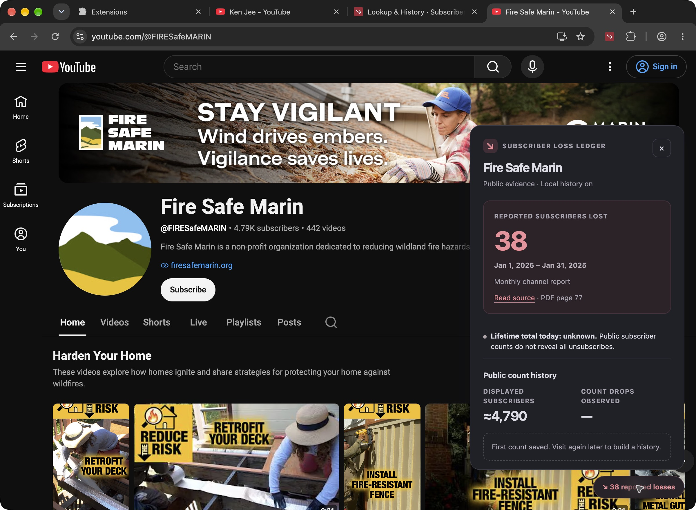

# YouTube Subscriber Loss Ledger

A Chrome Manifest V3 extension that displays cited historical subscriber-loss disclosures on YouTube channel pages and keeps a private, local history of displayed subscriber counts.

**Exact lifetime subscriber losses for arbitrary channels are unavailable.** This extension does not calculate or promise them. It includes ten historical records for four verified channels. Other channels show **Not disclosed**. Displayed-count decreases are tracked separately and are not gross unsubscribes.

## Install

Download the ZIP from [Releases](https://github.com/kyllan16693/youtube-subscriber-loss-ledger/releases), extract it, open `chrome://extensions`, enable Developer mode, choose **Load unpacked**, and select the extracted folder containing `manifest.json`. Alternatively, load this repository's `extension/` folder. Visit a YouTube channel and click the lower-right Subscriber losses button, or pin the toolbar popup.

No account, API key, server, build step, or runtime dependency is needed. The Chrome Web Store submission is being prepared; no store approval is claimed here.

## What you see

- Publisher-reported historical loss records with original reporting periods and source links: Ken Jee, saurabhschool, General Shale, and Fire Safe Marin.
- Current public subscriber counts from YouTube, marked approximate when abbreviated.
- Local observations, saved only when you visit or look up a channel, plus pause, forget, and JSON export controls.
- Clear unknown values when reports, dates, or counts are unavailable. Overlapping report periods are not summed.



## Privacy and permissions

The extension uses `storage`, `activeTab`, and access to `https://www.youtube.com/*`. Channel metadata requests omit account cookies. There is no telemetry, remote code, publisher backend, scheduled polling, or account connection. Read the [privacy policy](PRIVACY.md).

## Development

Use Node.js 20+ and Python 3.10+:

```sh
npm test
npm run check
npm run build
```

The dependency-free build writes a reproducible extension ZIP and SHA-256 checksum to `dist/`. The public test suite uses synthetic minimal YouTube page structures; these fixtures are not shipped in the extension. Earlier live checks on regular Google Chrome verified the on-channel panel, toolbar popup, public requests, report matching, unknown-report state, and local history controls. Live availability depends on YouTube; layout changes, consent pages, and rate limits can prevent lookup.

The extension currently supports desktop YouTube channel routes, not individual watch pages or the mobile domain. Bundled reports update through extension releases, not automatic discovery. Public reports are publisher disclosures, not independently authenticated Analytics API responses.

## License and sources

Original software is [MIT licensed](LICENSE). Third-party source material is separately described in [THIRD_PARTY_NOTICES.md](THIRD_PARTY_NOTICES.md). In particular, the saurabhschool dataset is CC BY-NC 3.0; this code license does not override source terms. Raw reports and creator datasets are not redistributed. This project is independent of Google, YouTube, and the channels shown.

## Support

[Open an issue](https://github.com/kyllan16693/youtube-subscriber-loss-ledger/issues) with reproducible steps. Do not include credentials or private browsing history.
